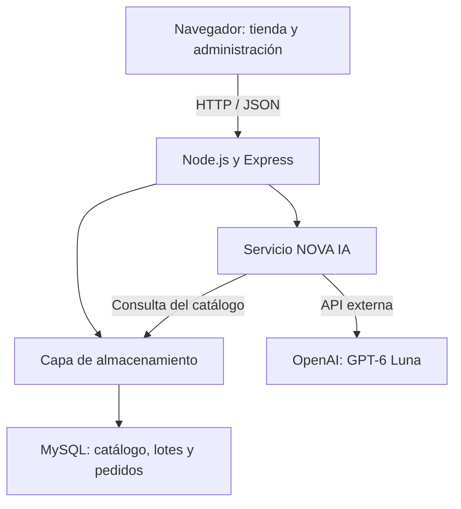

# NOVA SALUD PRO

## Sistema web académico de gestión de botica con asistente de inteligencia artificial

**Institución:** SENATI  
**Curso:** Fullstack Developer Software  
**Equipo:** Jorge Ponce, Esteban Gonzalez, Cristhian Romero 


## 1. Presentación y problema identificado

NOVA SALUD PRO integra una tienda pública, un panel administrativo y un asistente conversacional. El objetivo fue aplicar conocimientos de desarrollo fullstack a una botica: organizar productos, consultar existencias, registrar solicitudes y controlar lotes y vencimientos desde una misma aplicación.

Identificamos que una búsqueda tradicional exige conocer el nombre del producto. Un usuario puede expresar una consulta como «tengo moco» o «me duele la muela», sin conocer el nombre técnico de lo que busca. Por ello incorporamos NOVA IA, que interpreta lenguaje cotidiano y consulta información relacionada dentro del inventario disponible.

La integración de una IA en una página web era un aprendizaje nuevo para el equipo y todavía no se había trabajado en clase. Se desarrolló mediante investigación, revisión de documentación y apoyo de ChatGPT para comprender conceptos, proponer código y resolver dificultades. El equipo participó en la integración, configuración y pruebas del sistema. No se entrenó un modelo propio: se conectó la aplicación con un modelo existente mediante una API.

## 2. Objetivos

- Separar la consulta pública de las operaciones administrativas protegidas.
- Centralizar productos, lotes, solicitudes y movimientos en MySQL.
- Facilitar la búsqueda por nombre, principio activo, categoría y presentación.
- Incorporar un asistente que consulte el catálogo sin inventar productos ni existencias.
- Ejecutar la aplicación y la base de datos mediante Docker, sin depender de XAMPP.
- Aplicar validación de datos, control de acceso y pruebas automatizadas.

## 3. Tecnologías y responsabilidades

| Tecnología | Aplicación en el proyecto |
|---|---|
| React 18 | Componentes de tienda, administrador y chat |
| Vite 5 | Desarrollo y compilación de la interfaz |
| CSS y Lucide React | Diseño adaptable, temas e iconos |
| Node.js 22 o superior | Ejecución del servidor JavaScript |
| Express 4 | API REST, autenticación y entrega de la interfaz compilada |
| MySQL 8 y mysql2 | Persistencia relacional y conexiones desde Node.js |
| OpenAI SDK | Solicitudes al modelo mediante Responses API |
| GPT-6 Luna | Modelo elegido en la configuración de despliegue |
| dotenv | Lectura de variables de entorno en ejecución local |
| Docker y Docker Compose | Construcción, red interna y ejecución de servicios |
| GitHub y GitKraken | Organización del trabajo y control de versiones del equipo |
| node:test y assert | Pruebas unitarias y de integración |

La distribución de trabajo se organizó por áreas: interfaz, backend e integración de IA, y base de datos con Docker. El integrante 2 trabajó en backend, APIs e integración de OpenAI; el integrante 3 asumió la base de datos y Docker. Las áreas se integraron mediante rutas y estructuras de datos compartidas.

El proceso fue incremental: construir una función, conectarla con el resto del sistema, probarla y corregirla. Esta descripción resume las etapas técnicas del proyecto; no pretende sustituir un historial de commits ni atribuir fechas a cambios que el ZIP no permite verificar.

## 4. Arquitectura



El navegador no se conecta directamente a MySQL ni recibe la clave de OpenAI. Envía solicitudes al backend, que valida los datos y decide qué consultar o modificar.

En Docker existen dos servicios: `nova-salud` y `mysql-db`. El primero ejecuta Express y sirve también los archivos React compilados. El segundo ejecuta MySQL. No hay un contenedor independiente para el frontend en esta versión.

## 5. Desarrollo paso a paso

### Paso 1. Definir las secciones y los datos

Se separaron dos espacios: una tienda para visitantes y un panel privado para administrar la botica. Se definieron productos, presentaciones, categorías, lotes, pedidos, detalles del pedido y movimientos. Esta separación permitió diferenciar consultas públicas de modificaciones protegidas.

### Paso 2. Construir la interfaz pública

En `client/src/Store.jsx` se implementaron el catálogo, las tarjetas de productos, la ficha individual y el formulario de solicitud. La interfaz utiliza componentes reutilizables de `common.jsx` y estilos de `style.css`.

La búsqueda tradicional se separó del campo de consulta a la IA. El archivo `utils/filterCatalog.js` filtra por nombre, principio activo, concentración, presentación y categoría. Normaliza mayúsculas, tildes y espacios; combina búsqueda con categoría, presentación, disponibilidad y orden por nombre o precio.

El filtrado se actualiza mientras se escribe sobre los productos ya cargados en el navegador. Esto no implica sincronización continua con la base de datos: para ver cambios externos puede ser necesario recargar el catálogo.

### Paso 3. Crear el backend y las rutas REST

En `server/index.js` se configuró Express para recibir JSON, registrar rutas y servir `client/dist`. Las rutas se dividieron por responsabilidad: productos, autenticación, administración, pedidos, movimientos e IA.

Se utilizaron métodos HTTP según la operación: `GET` para consultar, `POST` para crear o enviar mensajes, `PATCH` para modificaciones parciales y `DELETE` para las operaciones que lo implementan. El servidor devuelve códigos como 400 para datos inválidos, 401 para acceso no autorizado y 409 para conflictos de stock o pedidos ya procesados.

### Paso 4. Conectar el catálogo con el almacenamiento

`server/store.js` ofrece una interfaz común de lectura, escritura y transacciones. Puede trabajar con archivos JSON para pruebas locales o delegar en `server/mysql-store.js` cuando `NOVA_STORAGE=mysql`.

La implementación MySQL utiliza un pool de conexiones. Los productos se relacionan con sus lotes; los pedidos contienen líneas de detalle. Así, la tienda, el administrador y el asistente consultan la misma fuente de información, en lugar de mantener catálogos independientes.

Las escrituras agrupadas se ejecutan en transacciones, con confirmación o reversión ante errores. También se utiliza un bloqueo de escritura de MySQL para coordinar operaciones del sistema académico.

### Paso 5. Incorporar el panel administrativo

`client/src/Admin.jsx` contiene inventario, pedidos, lotes, categorías, movimientos y reportes. La edición de productos se realiza en una ventana individual para evitar desplazarse hasta otro extremo de la página.

El administrador puede crear y editar productos, ajustar existencias, gestionar lotes, cambiar visibilidad y completar campos informativos. También puede renombrar categorías y presentaciones en el catálogo.

La autenticación del panel usa una contraseña configurada en el servidor y una sesión mediante cookie. No se implementa en esta versión un sistema completo de usuarios con roles de vendedor y administrador.

### Paso 6. Controlar solicitudes, stock y vencimientos

El cliente envía su nombre, un DNI ficticio y las cantidades solicitadas. El servidor obtiene los precios desde el catálogo y calcula el total; no confía en un total proporcionado por el navegador.

El pedido comienza como `Pendiente de revisión`. El administrador puede aprobarlo como `Aprobado y entregado` o marcarlo `Rechazado`. Al aprobar, se verifica nuevamente la disponibilidad y se exige la confirmación de revisión. Cuando corresponde, también se solicita confirmar la revisión de receta.

El stock disponible se calcula con los lotes vigentes y sus cantidades positivas. El descuento comienza por los lotes que vencen antes, aplicando el criterio FEFO —primero en vencer, primero en salir—. Se impide procesar dos veces el mismo pedido. Rechazar una solicitud no descuenta existencias.

### Paso 7. Ampliar las fichas para el asistente

Un nombre comercial y un precio no bastan para orientar una consulta. Por eso se añadieron indicaciones, advertencias, contraindicaciones, fuente farmacológica, términos de búsqueda, estado de revisión y condición de receta.

En MySQL estos datos complementarios se guardan en `producto_clinica`, vinculada por el identificador del producto. Al arrancar en modo MySQL, el servidor intenta crear esa tabla si no existe. La conexión necesita los permisos correspondientes.

El estado `Revisado` es un dato registrado por el administrador; no constituye una certificación ni una validación automática de una autoridad sanitaria.

### Paso 8. Integrar NOVA IA con OpenAI

Se creó el componente `NovaChat.jsx` para escribir mensajes, mostrar respuestas, conservar el hilo mientras está abierto y presentar fichas del catálogo. El componente se comunica con `POST /api/ai/chat`.

La ruta `asistenteReact.js` valida los mensajes y mantiene sesiones temporales. El servicio `novaChat.js` ejecuta la lógica del asistente. La clave permanece en el servidor y el modelo se toma de las variables de entorno.

La configuración de Compose del ZIP ya utiliza `gpt-6-luna` como valor predeterminado. El servicio JavaScript conserva `gpt-4o-mini` como último valor alternativo si no recibe ninguna variable de modelo; por ello se definen explícitamente ambos nombres de modelo al desplegar.

### Paso 9. Integrar y ejecutar con Docker

Se preparó un Dockerfile de dos etapas. La primera instala dependencias y compila React; la segunda copia los archivos necesarios y ejecuta Node.js con el usuario `node`.

Compose inicia MySQL y espera su comprobación de salud antes de iniciar la aplicación. El backend accede a `mysql-db:3306` mediante la red interna de Docker. El navegador accede a `http://localhost:3000`.

La persistencia de MySQL se conserva en el volumen `botica_nova_salud_mysql_data`. El respaldo SQL se monta como archivo de inicialización para una base nueva; no se vuelve a importar automáticamente cada vez que se reinician los contenedores.

### Paso 10. Verificar e iterar

Se incorporaron pruebas para filtros, interpretación local, acceso administrativo, pedidos y conversaciones. Las observaciones del equipo ayudaron a separar el buscador del catálogo, mejorar la edición individual y revisar los datos necesarios para la IA.

La revisión del ZIP distingue las funciones terminadas de las propuestas posteriores, que se enumeran al final de este documento.

## 6. Cómo funciona la inteligencia artificial

Una interacción normal con el proveedor externo sigue esta secuencia:

1. El usuario escribe una pregunta y React envía `message` y, si existe, `conversationId`.
2. Express comprueba formato, longitud, propiedad de la conversación y límite de solicitudes.
3. El servicio carga el catálogo y aplica comprobaciones locales de contexto y señales de alarma.
4. Una primera llamada a OpenAI extrae hasta ocho términos de búsqueda relacionados con la conversación.
5. El backend busca coincidencias en nombres y campos informativos, y selecciona hasta doce candidatos según las reglas del servicio.
6. Una segunda llamada recibe las fichas seleccionadas y solicita una respuesta estructurada con `message`, `followup`, `productIds`, `warnings` y `urgent`.
7. El servidor valida la respuesta y vuelve a consultar el inventario. Solo devuelve productos elegibles que continúan disponibles; limita la selección a ocho identificadores.
8. React muestra la respuesta y las tarjetas con datos del servidor.

Se utiliza `text.format` con un esquema JSON estricto para organizar la respuesta. La IA propone identificadores; el servidor controla cuáles se aceptan. Los precios y existencias visibles proceden del catálogo, no de texto inventado por el modelo.

Este enfoque combina recuperación de información del catálogo con generación de lenguaje. No se implementó una base vectorial ni un entrenamiento con datos propios: la recuperación usa términos, normalización y puntuación de coincidencias.

### Memoria y respaldo

Las conversaciones se mantienen en memoria del servidor, con hasta veinte mensajes y una caducidad de treinta minutos de inactividad. Se vinculan al navegador mediante cookie y se pierden al reiniciar la aplicación. No se guardan como historial permanente en MySQL.

Si la IA está desactivada, falta la clave, el proveedor falla o su salida no es válida, el servicio utiliza respuestas locales limitadas. La interfaz informa `Modo local limitado`; recibir una respuesta no demuestra por sí solo que Luna esté funcionando. Cuando el proveedor completa el flujo, la respuesta incluye `mode: "ia"`.

Las llamadas del código usan `store:false`, un tiempo de espera de veinte segundos por solicitud y ningún reintento automático. La consulta y las fichas seleccionadas se envían a un servicio externo; para la demostración deben utilizarse datos ficticios.

### Reglas de uso responsable

El asistente tiene instrucciones para no diagnosticar ni indicar dosis personalizadas. Evita asociar automáticamente síntomas con antibióticos, diferencia la consulta de una ficha de una sugerencia por síntomas y prioriza atención presencial ante ciertas señales de alarma.

Se filtran productos ocultos, sin existencias y fichas no revisadas en las consultas por síntomas. También se aplican restricciones según antecedentes o edad mencionados. Estas reglas reducen errores, pero son controles de un prototipo académico y no garantizan seguridad clínica.

## 7. Aporte innovador y aprendizaje

La innovación del proyecto consiste en incorporar una conversación en lenguaje natural a un catálogo administrado y conectado a existencias reales del sistema. El usuario puede iniciar una consulta sin saber el nombre comercial, mientras el backend mantiene el control de productos, disponibilidad y presentación de resultados.

Es un aporte innovador para el alcance académico del equipo y para la experiencia de esta aplicación; no se afirma que sea la primera farmacia con inteligencia artificial ni que sustituya el trabajo del químico farmacéutico.

La implementación permitió aprender a consumir una API externa, proteger credenciales, redactar instrucciones para un modelo, procesar salidas estructuradas, conservar contexto, controlar fallos y comprobar respuestas contra una base de datos. El apoyo de IA durante el desarrollo se utilizó como herramienta de aprendizaje y asistencia técnica, y no como evidencia de que todo código generado sea correcto sin revisión.

## 8. Estructura principal del repositorio

| Ruta | Responsabilidad |
|---|---|
| `client/src/Store.jsx` | Tienda, catálogo y solicitudes |
| `client/src/Admin.jsx` | Panel administrativo |
| `client/src/NovaChat.jsx` | Interfaz del asistente |
| `client/src/utils/filterCatalog.js` | Búsqueda y filtros del catálogo |
| `client/src/admin/admin-utils.js` | Búsqueda administrativa y generación CSV |
| `server/index.js` | Servidor y registro de rutas |
| `server/routes/` | Controladores HTTP |
| `server/services/novaChat.js` | Orquestación del chat y consulta de OpenAI |
| `server/services/clinical.js` | Reglas de revisión y condición de receta |
| `server/services/interpretarSintomas.js` | Interpretación local para el flujo compatible |
| `server/store.js` | Operaciones comunes de persistencia y stock |
| `server/mysql-store.js` | Adaptador MySQL y transacciones |
| `sql/` | Esquema y ampliación de información clínica |
| `scripts/` | Comprobación e importación de datos |
| `tests/` | Pruebas automatizadas y scripts de verificación |
| `Dockerfile` y `compose.yaml` | Construcción y ejecución de contenedores |

Las rutas heredadas `/api/productos` y `/api/asistente` permanecen para compatibilidad. El chat de React utiliza `/api/ai/chat`; no debe confundirse con el flujo anterior.

## 9. API principal

| Método | Ruta | Uso y acceso |
|---|---|---|
| GET | `/api/health` | Estado básico del servidor |
| GET | `/api/products` | Productos públicos visibles |
| GET | `/api/products/:id` | Ficha pública |
| POST | `/api/products` | Crear producto; sesión administrativa |
| PATCH | `/api/products/:id` | Editar producto; sesión administrativa |
| DELETE | `/api/products/:id` | Ocultar producto; sesión administrativa |
| PATCH | `/api/products/:id/stock` | Ajustar stock; sesión administrativa |
| POST | `/api/products/:id/lots` | Agregar lote; sesión administrativa |
| PATCH | `/api/products/:id/lots/:lotId` | Editar lote; sesión administrativa |
| POST | `/api/auth/login` | Iniciar sesión |
| GET | `/api/auth/status` | Consultar sesión |
| POST | `/api/auth/logout` | Cerrar sesión |
| GET | `/api/admin/products` | Inventario administrativo |
| GET | `/api/admin/stats` | Indicadores administrativos |
| PATCH | `/api/admin/categories` | Renombrar categoría |
| PATCH | `/api/admin/presentations` | Renombrar presentación |
| GET | `/api/meta` | Categorías y presentaciones; acceso administrativo |
| POST | `/api/orders` | Registrar solicitud pública |
| GET | `/api/orders` | Consultar pedidos; sesión administrativa |
| PATCH | `/api/orders/:id/status` | Aprobar o rechazar; sesión administrativa |
| GET | `/api/movements` | Consultar movimientos; sesión administrativa |
| POST | `/api/ai/chat` | Conversar con NOVA IA |
| DELETE | `/api/ai/chat/:id` | Finalizar conversación del navegador propietario |

`/api/ai/symptoms` mantiene un alias del chat. La comprobación `/api/health` no realiza una prueba completa de MySQL ni de OpenAI.

## 10. Ejecución con Docker

### Requisitos

Docker con Compose disponible, acceso a Internet para obtener imágenes y consultar OpenAI, y credenciales configuradas por el equipo. Para ejecutar con Docker no es necesario instalar XAMPP ni Node.js en el equipo anfitrión.

### Configuración

Crear o editar `.env` junto a `compose.yaml`. Utilizar valores privados propios; los siguientes son marcadores, no credenciales funcionales:

```env
NOVA_ADMIN_PASSWORD=REEMPLAZAR_CON_CONTRASENA_PRIVADA_SEGURA
COOKIE_SECURE=false
MYSQL_DATABASE=nova_salud
MYSQL_USER=nova_salud
MYSQL_PASSWORD=REEMPLAZAR_CON_CLAVE_MYSQL
MYSQL_ROOT_PASSWORD=REEMPLAZAR_CON_CLAVE_ROOT
AI_ENABLED=true
OPENAI_API_KEY=REEMPLAZAR_CON_CLAVE_OPENAI
OPENAI_MODEL=gpt-6-luna
NOVA_AI_MODEL=gpt-6-luna
```

La contraseña administrativa debe tener al menos doce caracteres y no conservar el prefijo de ejemplo `CAMBIAR_POR`. Las credenciales MySQL de una instalación existente deben coincidir con las almacenadas en esa base: cambiar el archivo `.env` no cambia automáticamente las contraseñas del volumen ya creado.

Compose fija `NOVA_STORAGE=mysql`, `MYSQL_HOST=mysql-db`, `MYSQL_PORT=3306`, `PORT=3000` y `NOVA_HOST=0.0.0.0` dentro del contenedor. La publicación `127.0.0.1:3000:3000` limita el acceso directo al equipo local.

El archivo `backups/nova_salud_backup.sql` debe estar disponible para la inicialización prevista en Compose. Está incluido en el ZIP revisado, pero `backups/` está excluido por `.gitignore`; al obtener el proyecto desde GitHub debe coordinarse su entrega o preparar una inicialización equivalente revisada por el responsable de base de datos.

### Arranque inicial

Desde la raíz del proyecto:

```powershell
docker compose config --quiet
docker compose up -d --build
docker compose ps
docker compose exec nova-salud node scripts/check-mysql.mjs
```

Abrir la tienda en `http://localhost:3000` y el panel en `http://localhost:3000/admin`.

### Actualizar sin rehacer la base de datos

Si solo cambiaron las variables de IA:

```powershell
docker compose up -d --force-recreate --no-deps nova-salud
```

Si cambió el código:

```powershell
docker compose up -d --build --no-deps nova-salud
```

Estos comandos presuponen que MySQL ya está funcionando. No borrar el volumen para actualizar la interfaz o la IA. `docker compose down -v` elimina volúmenes y puede causar pérdida de datos.

Para detener temporalmente el sistema:

```powershell
docker compose stop
```

### Comprobar Luna

Abrir una conversación nueva, enviar una consulta y revisar la respuesta de `/api/ai/chat` en las herramientas de red del navegador. `mode: "ia"` indica que el flujo externo completó las llamadas; `mode: "local"` indica respaldo local.

Para comprobar qué modelo recibió el contenedor sin imprimir la clave:

```powershell
docker compose exec nova-salud node -e "console.log({enabled:process.env.AI_ENABLED,model:process.env.OPENAI_MODEL,novaModel:process.env.NOVA_AI_MODEL,keyConfigured:Boolean(process.env.OPENAI_API_KEY)})"
```

El servicio captura los fallos del proveedor sin registrar su detalle en `novaChat.js`. Por ello, los logs pueden mostrar que el servidor está activo sin explicar por qué el chat cayó al modo local. Deben revisarse configuración, acceso al modelo y disponibilidad de uso de la cuenta; nunca imprimir la clave para diagnosticar.

## 11. Pruebas y evidencias

Durante la preparación de este README se ejecutaron las pruebas `*.test.js` del ZIP en una copia aislada, sin utilizar credenciales privadas. **Resultado: 60 pruebas aprobadas y 0 fallidas.**

La cobertura incluye filtros sin tildes, exportación CSV, interpretación local, respuestas de OpenAI simuladas, validación de identificadores, control de productos no disponibles, autenticación, creación y edición, lotes, pedidos, aprobación concurrente, auditoría, sesiones y reversión de escrituras JSON.

Este resultado no acredita una llamada real a Luna ni una ejecución nueva de Docker o MySQL. El funcionamiento de Docker fue reportado por el equipo; la revisión documental confirma su configuración. Las pruebas de integración automatizadas usan almacenamiento JSON temporal y las pruebas de proveedor usan simulaciones.

Para reproducir las pruebas fuera del contenedor de producción, con Node.js 22 o superior:

```powershell
npm.cmd ci
npm.cmd run build
npm.cmd test
```

En otras terminales puede utilizarse `npm` en lugar de `npm.cmd`. La compilación debe ejecutarse antes de las pruebas HTTP que verifican la entrega de React. La imagen final de Docker no incluye la carpeta `tests`.

También existen `tests/mysql-smoke.mjs` y `tests/ui-smoke.mjs`. No forman parte de `npm test`; el primero requiere un entorno MySQL de pruebas y el segundo necesita Playwright y su navegador, que no figuran como dependencias del proyecto. Deben prepararse antes de ejecutarlos.

### Demostración sugerida para la exposición

1. Mostrar los dos servicios activos con `docker compose ps`.
2. Buscar un producto por nombre y combinar categoría y presentación.
3. Entrar al panel y editar un producto de prueba.
4. Recargar la tienda y comprobar que el cambio aparece.
5. Consultar NOVA IA sobre ese producto y explicar el recorrido navegador → backend → catálogo → OpenAI → validación.
6. Crear una solicitud con datos ficticios y aprobarla una sola vez.
7. Verificar el descuento de stock y el movimiento registrado.
8. Mostrar el resultado de las pruebas y explicar sus límites.

## 12. Seguridad y límites técnicos

- Las claves se configuran en el servidor. `.env` está excluido por `.gitignore` y `.dockerignore`; también debe excluirse manualmente de entregas ZIP públicas.
- La aplicación valida entradas y protege operaciones administrativas. La API heredada `/api/productos` utiliza además `ADMIN_API_KEY`; esta variable no está transmitida por el Compose revisado, por lo que sus escrituras requieren configuración adicional si se van a utilizar. El panel actual utiliza sesiones.
- Las sesiones administrativas y de conversación se guardan en memoria; reiniciar el servidor obliga a renovarlas.
- `COOKIE_SECURE=false` corresponde a la demostración local con HTTP. Un despliegue público requiere revisar HTTPS, sesiones, permisos y protección del servicio.
- El historial de movimientos conserva hasta mil entradas; no es un archivo de auditoría permanente e ilimitado.
- El adaptador MySQL reescribe colecciones completas de lotes o detalles en determinadas operaciones. Es una solución académica que debe evolucionar hacia actualizaciones por registro para mayores volúmenes y concurrencia.
- Los campos clínicos necesitan contenido fiable y revisión humana. La presencia de una fuente escrita no acredita por sí sola su validez.

## 13. Funciones existentes y mejoras pendientes

| Función | Estado en el ZIP revisado |
|---|---|
| Catálogo con búsqueda mientras se escribe | Implementado |
| Filtros de categoría, presentación, stock y orden | Implementados |
| Alta y edición individual de productos | Implementadas |
| Ocultar un producto | Disponible mediante visibilidad y ruta DELETE de baja lógica |
| Botón explícito para eliminar productos en la tabla | No aparece en esta versión |
| Crear y editar lotes | Implementado |
| Eliminar lotes y buscarlos por nombre de producto | Pendiente en el panel |
| Aprobar o rechazar solicitudes | Implementado |
| Eliminar, archivar o reembolsar pedidos procesados | Pendiente |
| Filtrar pedidos por cliente, fechas y estado | Pendiente en la interfaz revisada |
| Renombrar categorías y presentaciones | Implementado |
| Eliminar categorías o presentaciones con reasignación | Pendiente |
| Exportaciones CSV de inventario, pedidos, lotes y movimientos | Implementadas |
| Retirar la vista imprimible | Pendiente: el botón sigue en reportes |
| Usuarios independientes y roles de vendedor | No implementados |
| Chat con catálogo y respaldo local | Implementado |
| Luna como modelo configurado en Docker | Configurado; requiere credenciales y prueba externa satisfactoria |

## 14. Aprendizajes y conclusión

El proyecto permitió integrar una interfaz React, una API REST, una base relacional y un servicio de inteligencia artificial en una aplicación ejecutable con Docker. El aprendizaje principal fue comprender que agregar IA requiere más que insertar un chat: hay que recuperar datos, proteger credenciales, validar salidas y prever fallos.

NOVA SALUD PRO demuestra una aplicación práctica de estas técnicas en una botica académica. La siguiente etapa consiste en completar las mejoras administrativas pendientes y ampliar la evaluación del asistente con casos controlados y revisión profesional de las fichas.

## 15. Referencias para continuar el aprendizaje

- [React](https://react.dev/learn)
- [Vite](https://vite.dev/guide/)
- [Node.js](https://nodejs.org/en/learn)
- [Express](https://expressjs.com/)
- [MySQL 8](https://dev.mysql.com/doc/refman/8.0/en/)
- [Docker Compose](https://docs.docker.com/compose/)
- [OpenAI: Responses API](https://developers.openai.com/api/docs/guides/text)
- [OpenAI: salidas estructuradas](https://developers.openai.com/api/docs/guides/structured-outputs)

Las rutas, comandos y estados descritos se basan en los archivos del ZIP revisado. Las referencias sirven para profundizar; no reemplazan la verificación del comportamiento de esta versión.
